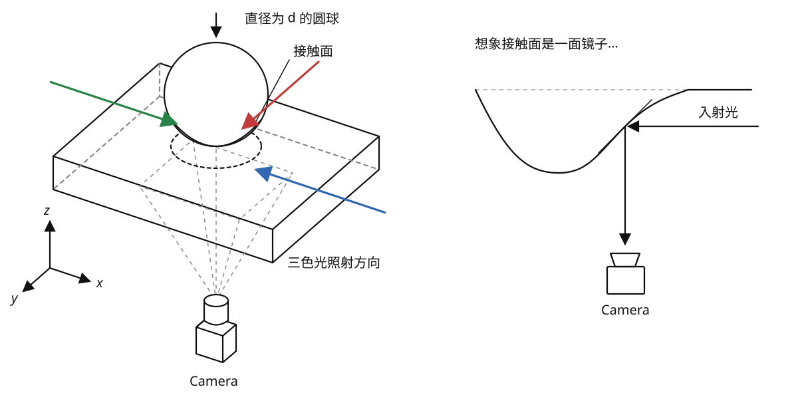
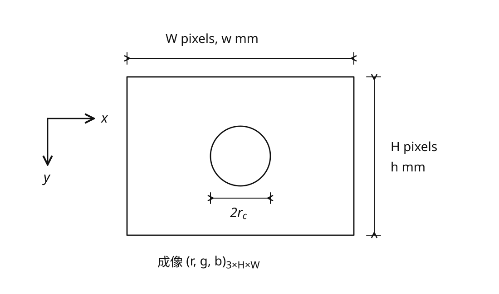
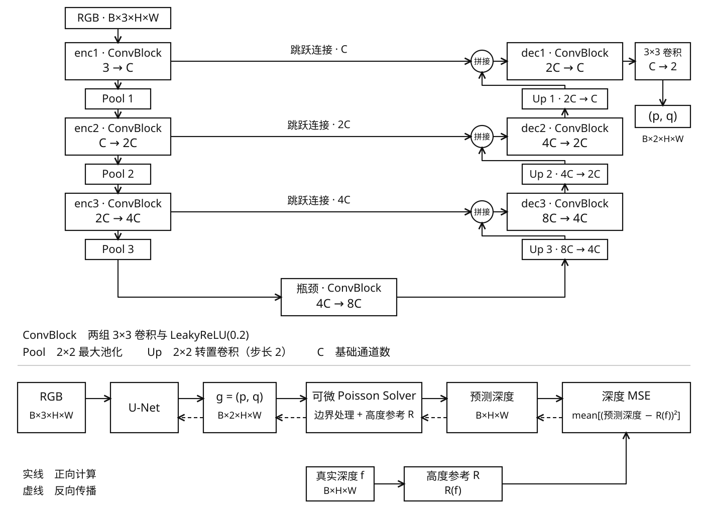

# 基于立体光梯度和漫反射层的视触觉传感器 （GelSight-like） 深度重建原理

## 0. 符号约定

$(r,g,b)$：RGB 图像数组，$(r,g,b)\in{\[0,1\]}^{3\times H\times W}$

$f$：真实深度，$\hat f$：重建深度，单张均为 $H\times W$（即一张单通道图），单位 mm，向内压入为正；$j=\sqrt{-1}$

$p=g_x\approx f_x$，$q=g_y\approx f_y$：通过算法得到的梯度，$x,y$ 为图像像素坐标，分别向右、向下。

连续式用 $f_x,f_y$ 表示变化率；代码实际使用相邻像素的深度差：

$$
D_xf(x,y)=f(x+1,y)-f(x,y),\qquad D_yf(x,y)=f(x,y+1)-f(x,y).
$$

网络输出 $g=(p,q)$，大小为 $2\times H\times W$；积分时不使用 $p$ 的最后一列、$q$ 的最后一行。

$\mathcal{F}$：Fourier 变换，$\mathcal{F}^{-1}$：逆 Fourier 变换；$P=\mathcal{F}[p]$，$Q=\mathcal{F}[q]$，$F=\mathcal{F}[\hat f]$。

## 1. 标定

此步的目的：获取 $(r,g,b)\rightarrow(p,q)$ 映射，即将图像转为梯度图。

使用球径、接触圆中心与半径，以及像素尺度，可以先算出深度图，再通过像素差分得到梯度图。接触圆半径记为 $r_c$，避免与 RGB 中的 $r$ 混淆。

### 圆球的深度计算

球直径为 $d$，球半径 $R=d/2$，单位 mm。接触圆中心为 $(c_x,c_y)$、半径为 $r_c$，均使用原始裁剪图像的像素坐标。设毫米/像素比例为 $s$（`mm_per_pixel`），则接触圆的物理半径为 $a=sr_c$，像素 $(x,y)$ 到圆心的物理距离为

$$
\rho=s\sqrt{(x-c_x)^2+(y-c_y)^2}.
$$

以接触圆周所在平面为零，球面压入深度为

$$
f(x,y)=\begin{cases}
\sqrt{R^2-\rho^2}-\sqrt{R^2-a^2},&\rho\le a,\\
0,&\rho>a,
\end{cases}\qquad 0<a<R.
$$

圆周深度为 0，中心深度为 $R-\sqrt{R^2-a^2}$。这就是 `calibration.py` 采用的球面帽近似；球径 $d$ 和像素尺度 $s$ 都需实测，接触圆需要完整地落在图像内。

我们可以用

- 查找表（Look-up Table）
- 神经网络（MLP或U-Net）

获得 $(r,g,b)$ 到 $(p,q)$ 的映射。

## 2. 由梯度重建深度：解决 Poisson 方程

$$
\hat f_{xx}+\hat f_{yy}=\frac{\partial p}{\partial x}+\frac{\partial q}{\partial y}\qquad (*)
$$

$(*)$式 两边做 Fourier Transform：

$$
-(\omega_x^2+\omega_y^2)F=j\omega_xP+j\omega_yQ
$$

$$
\Rightarrow\quad F=\frac{j\omega_xP+j\omega_yQ}{-(\omega_x^2+\omega_y^2)},\qquad \omega_x^2+\omega_y^2>0.
$$

再取逆变换，

$$
\hat f=\mathcal{F}^{-1}[F]
$$

即深度图。零频 $F(0,0)$ 对应未确定的整体高度常数，需要另选参考；设 $F(0,0)=0$ 表示整张图的平均深度为零。

### 边界条件

仅有内部 Poisson 方程还不能确定整张表面，边界条件也要参与求解。对于完整、精确且可积的梯度，深度仍相差一个常数：$f$ 与 $f+C$ 的梯度相同。

本项目传感器工作流默认采用自然 Neumann 边界条件。设 $\Omega$ 为图像区域，$n$ 为边界向外的单位法向量，则

$$
\frac{\partial\hat f}{\partial n}=(p,q)\cdot n\qquad\text{在 }\partial\Omega\text{ 上}.
$$

即边界法向深度变化与预测梯度的法向分量相匹配。代码用 DCT-II 求解；本边界条件允许边缘高度变化。

Neumann 求解后还需要确定整体高度零点。记高度参考处理为 $\mathcal{R}(u)=u-\text{参考区域内 }u\text{ 的平均值}$：

- `reference_region: null`：参考为整圈边缘，减去边缘的平均深度。
- 指定 `[left, top, width, height]`：参考为这块区域，应选择已知未形变的位置，坐标以原始裁剪图像为准。

这里只做整体平移，不会压平边缘或参考区域。预测深度和真实深度采用同一个参考；如果参考也发生形变，得到的是相对该参考的深度。

`dirichlet` 模式则规定 $\hat f=0$ 在整圈边缘成立，用 DST-I 求解，仅适用于整圈边缘都处于未形变零面的情况。

## 3. 基于 U-Net 的深度重建算法

### 3.1. 标定图像采集流程

a. 小批量采集按压图像，可使用机械臂或手动

b. YOLO 人工标定球压痕区域，训练 YOLO 模型识别球的圆形压痕

c. 采集大量球按压图像，使用 YOLO 模型自动识别按压中心、半径，据此生成深度图或梯度图

### 3.2. 模型结构、训练方法

模型对应 `model.py` 的 `UNet2D`：三次下采样、三次上采样，编码器与解码器通过通道拼接连接。$C$ 为 `base_channels`；每个卷积块是两组“$3\times3$ 卷积 + LeakyReLU(0.2)”。下采样为 $2\times2$ 最大池化，上采样为核大小、步长均为 2 的转置卷积；拼接前若尺寸不同，用双线性插值对齐。最后用 $3\times3$ 卷积输出两个梯度通道，不加末端激活。

预测梯度经可微 Poisson Solver 和高度参考得到 $\hat f$。根据 `loss.py`，默认损失是对整个批次所有深度像素取平均的 MSE：

$$
L_{\mathrm{depth}}=\frac{1}{BHW}\sum_{b=1}^{B}\sum_{y=1}^{H}\sum_{x=1}^{W}\left[\hat f_{b,y,x}-\mathcal{R}(f_b)_{y,x}\right]^2.
$$

这里 $B$ 为批次大小，$\hat f$ 已经过参考处理。

反向传播沿“损失 → 预测深度 → 高度参考与 Poisson Solver → 梯度输出 → U-Net 参数”进行。真实深度只提供监督；Poisson Solver 没有待训练参数，但可以传递梯度。

### 3.3. 参考文献

1. R. Kota, K. Shah, J. E. Colgate and G. Reardon, "3D Cal: An Open-Source Software Library for Depth Reconstruction on Vision-Based Tactile Sensors," in IEEE Robotics and Automation Letters, vol. 11, no. 5, pp. 6248-6255, May 2026, doi: 10.1109/LRA.2026.3673994.
2. Neumann boundary condition, Wikipedia.
